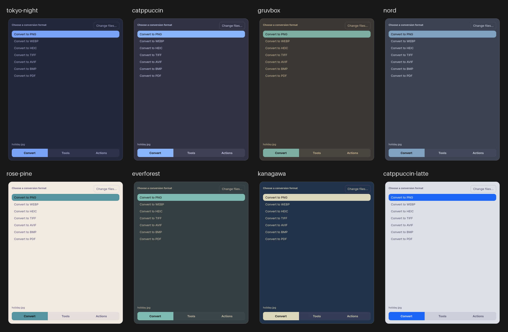
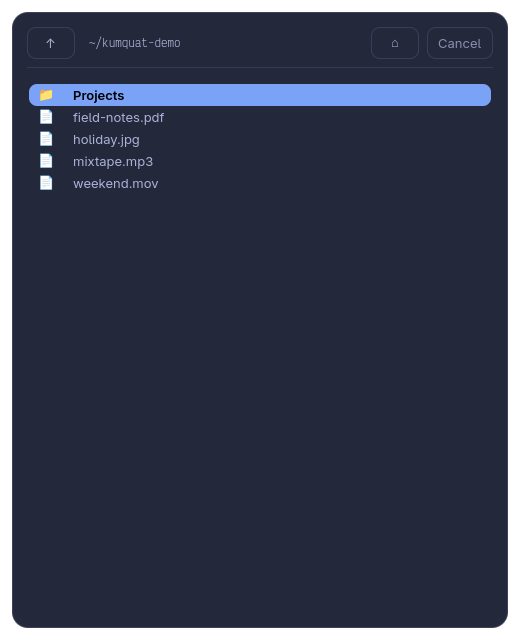
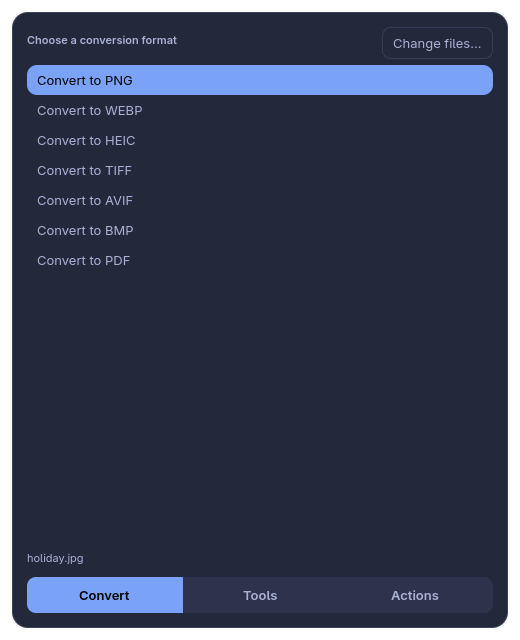
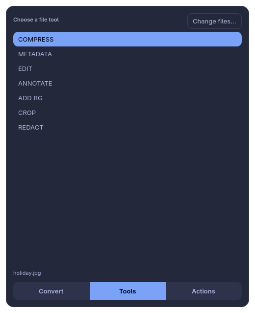
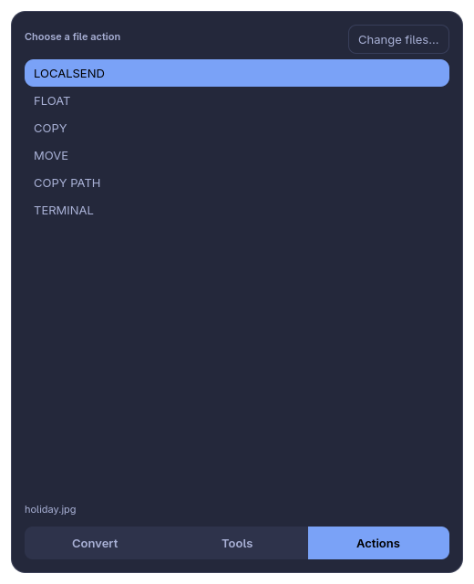
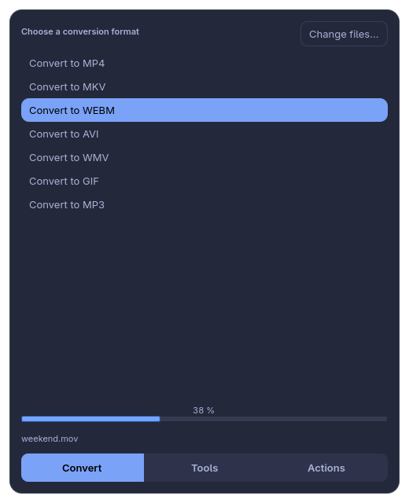
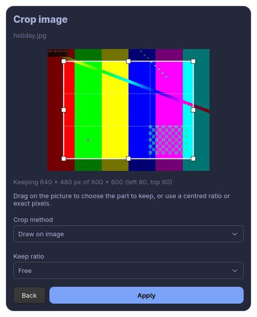
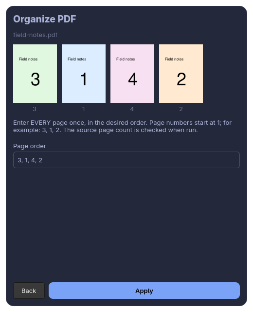

<div align="center">

# 🍊 Kumquat for Omarchy

**An offline file converter and toolbox, as an [Omarchy](https://omarchy.org) shell plugin: press a key, pick a file, done.**




<sub>The same window in eight stock Omarchy themes. Kumquat picks its colours from whichever theme you have active.</sub>

</div>

---

## Contents

[Highlights](#highlights) · [Install](#install) · [Dependencies](#dependencies) ·
[Open Kumquat](#open-kumquat) · [Optional shortcuts](#optional-shortcuts-and-files-integration) ·
[Using it](#using-it) · [Tools](#tools-and-their-settings) · [Themes](#works-with-omarchy-themes) ·
[Appearance](#appearance-glass-or-opaque) · [Update](#update) · [Remove](#remove) ·
[Command line](#command-line) · [Configuration](#configuration-reference) ·
[Troubleshooting](#troubleshooting) · [Development](#development) ·
[What is tested](#what-is-tested-and-what-is-not) · [Security and privacy](#security-and-privacy) ·
[License](#license-and-credits)

## Highlights

- **Two key presses to convert.** A small popup with its own file browser, or select files in
  Files (Nautilus) and press `Shift+E`.
- **275 conversion routes, 26 tools, 6 actions** across images, audio, video, PDF, documents,
  slides and archives (see [what is tested](#what-is-tested-and-what-is-not) for what that means).
- **Draw-on-image crop.** Drag a box on the picture like a photo editor, with 8 handles,
  ratio lock and arrow-key nudging.
- **PDF page thumbnails.** Reorder pages and watch the thumbnails move as you type.
- **Follows your Omarchy theme.** Switch themes and the next window matches.
- **Private by design.** Everything runs locally. No uploads, no telemetry, no accounts.
- **Safe by default.** Your original files are never modified and existing outputs are never
  overwritten. (*Move* is the one action that moves originals, and only when you ask.)
- **Share with LocalSend.** Hands your files to the LocalSend app you already have.
- **Opens from the shell.** A bar button, `omarchy-shell shell summon`, or your own keybinding.

> **Unofficial.** Kumquat is an independent Linux implementation inspired by the Mac app
> *Tangerine*. It is not affiliated with, endorsed by, or distributed by its developer.

## Screenshots

| Pick a file | Convert | Tools | Actions |
|:--:|:--:|:--:|:--:|
|  |  |  |  |

| Progress | Crop | Organize PDF |
|:--:|:--:|:--:|
|  |  |  |

<sub>All screenshots are rendered from the real widgets with synthetic files
(`tests/make_screenshots.py`). No desktop capture or personal file is used.</sub>

## Install

You need Omarchy with the Quattro shell, which provides the `omarchy plugin` command.

```bash
# 1. Add the plugin (asks you to confirm; it never runs plugin code or asks for sudo)
omarchy plugin add https://github.com/SulaimanBaeisa/omarchy-plugin-kumquat.git --enable

# 2. Install the dependencies (see "Dependencies" below for what each one is for)
sudo pacman -S --needed python gtk4 python-gobject python-pillow python-pymupdf \
  ffmpeg imagemagick libheif libavif poppler qpdf

# 3. Optional: put a Kumquat button in the bar
omarchy bar move io.github.sulaimanbaeisa.kumquat --section right
```

The plugin writes **nothing outside its own folder**
(`~/.config/omarchy/plugins/io.github.sulaimanbaeisa.kumquat/`); the only other change is Omarchy
recording in `~/.config/omarchy/shell.json` that it is enabled. Desktop shortcuts and the Files
integration are a separate, opt-in step: see [Optional shortcuts](#optional-shortcuts-and-files-integration).

To read the code first, run step 1 without `--enable` and enable it later with
`omarchy plugin enable io.github.sulaimanbaeisa.kumquat`. The part the shell loads is three small files
(`Overlay.qml`, `BarWidget.qml`, `Launch.js`); they only start Kumquat's own window.

## Dependencies

Kumquat is a normal desktop program that the plugin starts. It needs the **system** Python
(`/usr/bin/python3`), because that is the one with GTK's Python bindings; a virtualenv alone does
not provide the GUI.

**Required for the core app** (Python 3.11+, GTK 4.12+):

```bash
sudo pacman -S --needed python gtk4 python-gobject python-pillow python-pymupdf \
  ffmpeg imagemagick libheif libavif poppler qpdf
```

**Optional, per feature.** A missing optional backend only disables the routes that need it:

| Package | Needed for |
|---|---|
| `libreoffice-still` | Word / Excel / PowerPoint / OpenDocument conversions |
| `pandoc` | Markdown, EPUB, text-document conversions |
| `7zip` | Extracting RAR / 7z and other archives |
| `exiftool` | Removing metadata from most image/media formats |
| `wl-clipboard` | Clipboard actions (*Copy*, *Share*) |
| `nautilus-python` | The `Shift+E` shortcut and the context-menu entry in Files |
| `localsend` | The *Share* action |

Some image formats also need the Python plugins `pillow-heif` / `cairosvg`.

Not required: Node.js, Qt, Quickshell packages (the shell already has them), or any network access.

## Open Kumquat

Three ways, all starting the same window:

1. **The bar button** (🍊), if you ran step 3 above. Any mouse button opens the file picker.
   To change the icon, add an inline setting to the widget's entry in
   `~/.config/omarchy/shell.json`: `{ "id": "io.github.sulaimanbaeisa.kumquat", "icon": "…" }`.
2. **The shell command**, which you can bind to any key or call from a script:

   ```bash
   omarchy-shell shell summon io.github.sulaimanbaeisa.kumquat '{}'
   # open it on specific files, on a given tab (conversions | tools | actions):
   omarchy-shell shell summon io.github.sulaimanbaeisa.kumquat \
     '{"files": ["/home/me/photo.jpg"], "tab": "conversions"}'
   ```

   File paths must be absolute. A malformed payload is reported in the shell log and Kumquat still
   opens on its file picker.
3. **`Super+E`** and **`Shift+E` in Files**, once you run the optional installer below.

## Optional shortcuts and Files integration

```bash
python3 ~/.config/omarchy/plugins/io.github.sulaimanbaeisa.kumquat/scripts/install-shortcuts.py
hyprctl reload && hyprctl configerrors     # the second command must print nothing
```

Then **restart Files once**, press **`Super+E`**, and pick a file.

This script is the only part that edits your configuration, and only because you ran it. It backs
up every file it changes (`*.bak.<timestamp>`), keeps your other shortcuts (including Email), is safe
to run repeatedly, and prints what it did. It adds:

| What | Where |
|---|---|
| A `kumquat` command that runs the plugin | `~/.local/bin/kumquat` |
| `Super+E` opens the file browser (`Super+Shift+E` stays Omarchy's Email) | a marked block in `~/.config/hypr/bindings.lua` |
| A small floating, centred 520 × 640 popup instead of a tiled window | a marked block in `~/.config/hypr/hyprland.lua` |
| `Shift+E` in Files opens Kumquat on the selected files; a context-menu entry **Open in Kumquat** | `~/.local/share/nautilus-python/extensions/` and `~/.local/share/nautilus/scripts/` |

`Shift+E` is **not** a global shortcut: it only fires inside Files, so capital *E* keeps working
everywhere else, including in Files' rename, search and location fields.

Keep the plugin where `omarchy plugin add` put it. If you ever move it, run the installer again.

**Coming from the standalone Kumquat checkout?** Running this installer replaces its `kumquat`
launcher and its `Super+E` block with ones that use the plugin (each changed file is backed up), so
afterwards you can delete the old checkout. The installer also migrates a build that still carries the
earlier name *Tangerine* (old files are kept in `~/.local/share/kumquat/legacy-backup/`).

**Popup rule by hand.** The window rule is a line of Hyprland **Lua configuration**, not a terminal
command: pasting it into a shell prints `syntax error` errors. It belongs inside
`~/.config/hypr/hyprland.lua` (Omarchy 4+). Check what the installer added:

```bash
grep -n -A3 "Kumquat window rule" ~/.config/hypr/hyprland.lua
```

To write it yourself, append this line with your editor (`omarchy-launch-editor ~/.config/hypr/hyprland.lua`)
and run `hyprctl reload`. Change the two numbers to resize it; delete the line to undo:

```lua
o.window("^(dev\\.kumquat\\.app)$", { float = true, center = true, size = { 520, 640 } })
```

The class must be spelled `dev.kumquat.app` with the doubled backslashes. Kumquat works without
the rule; the window is just larger and tiled.

## Using it

### Choosing a file

The popup has its **own file browser**, starting in your home folder. Click a folder to enter it,
click a file to see what you can do with it. The up button, `Backspace` or `Alt+Up` goes to the
parent; the home button returns home. **Change files…** returns to the browser. From Files, select
one or more files and press `Shift+E` (or use **Open in Kumquat**): Kumquat opens on their
**Actions** tab with no copying and no right-click.

### Keys and mouse

| Input | Result |
|---|---|
| Bottom **Convert · Tools · Actions** tabs | Choose the kind of operation |
| `←` `→` or `A` `D` | Switch tabs (wraps around) |
| Hold `Shift` / `Super` / `Ctrl` | Jump to Convert / Tools / Actions |
| `↑` `↓` | Select an option |
| Single-click an option | Select it without running it |
| **Double-click** an option, or `Enter` | Run it (or open its settings first) |
| `Esc` on a settings page | Go back without applying |
| `Esc` on the main list | Close (not while a job is running) |

An empty **Tools** tab means *no tools are offered for that file type*, not that something is
broken. For example, a PPTX offers PDF/JPG/PNG conversions but no tools.

### Big files: is it working?

Work runs in a background thread, so the window stays responsive. Audio/video conversions and
PDF→image show a **measured percentage**; other jobs show a moving bar and elapsed time
(`Working… 1 min 15 s`). Errors appear as `Failed: …`, never silently. Tabs and selection still
respond, but a second *Apply* and closing the window are refused until the job ends. There is no
general *Cancel* yet.

### Share with LocalSend

The **LOCALSEND** action uses the LocalSend app you already have. It opens (or raises) the app and
puts your selected files on the Wayland clipboard: press **`Ctrl+V`** in LocalSend or drag the
files in, then pick the device.

Why not send directly? LocalSend's tray app already owns its network port, so a second
`localsend-cli` fails with *Address already in use*. If only `localsend-cli` is installed, Kumquat
opens its device list in a terminal with the files preselected instead. **Honest limit:** Kumquat
does not transfer the files itself, and whether `Ctrl+V` accepts files depends on your LocalSend
version.

## Tools and their settings

Tools that need choices open a settings page **inside the same window**. Press **Apply** to start;
**Back** changes nothing. Invalid values stay on the page with an explanation.

| Tool | What you set |
|---|---|
| **Crop image** | **Draw on image**, a centred ratio, or left/top/width/height in pixels |
| Crop / redact video, redact image | Pixel coordinates (no drawing yet) |
| Trim / bleep | Start and end in seconds — no silently chosen end |
| Speed / split / snapshot | Speed factor, clip length, or snapshot time |
| Edit / annotate image | Enhancement values, or text + position + colour |
| **Organize PDF** | New page order, with a live thumbnail strip |
| Move | An absolute destination folder, with overwrite protection |

**Draw-on-image crop.** Drag on empty space to draw a box, drag inside it to move it, drag any of
its 8 handles to resize, or nudge with the arrow keys (`Shift` = bigger steps). **Keep ratio** locks
1:1, 4:3, 3:2, 16:9 or 9:16. A line under the picture shows exactly how many pixels you are keeping,
and the pixel fields stay in sync. Phone photos are shown upright and cropped exactly where you see
the box. Drawing needs **one** readable image; with several, pick a ratio or pixels instead.

**Organize PDF.** A strip of small page thumbnails shows every page. Type the new order using page
numbers from 1, each page once (`3, 1, 4, 2`) and the strip reorders as you type. An incomplete
order keeps the current strip and says why. Needs one readable, unlocked PDF; the first 120 pages
are drawn.

This is not a full freehand editor or an automatic face detector.

## Works with Omarchy themes

Kumquat reads the colours of your **active Omarchy theme**, so it looks native on any of them
without configuration.

1. Omarchy publishes the live palette at `~/.local/state/omarchy/current/theme/colors.toml`.
2. Every time Kumquat opens, it reads that file and derives six colours from it: background,
   foreground, accent, a slightly lighter panel surface, muted text and the text colour used on the
   selected row.
3. Themes name their colours differently, so each role tries several keys (for example
   `lighter_bg`, `lighter_background`, then `color0`) before it derives a value from the colours the
   theme *does* provide.
4. If the file is missing or broken, Kumquat falls back to a built-in palette instead of failing: a
   dark one, or a light one when the theme says `mode = "light"`.

**Readability is enforced, not hoped for.** The selected row's text must reach a 4.5 : 1 contrast
ratio against the accent colour, and body text against the panel surface; if a theme's own values
would be too faint, black or white is used instead. Colours from the theme file are validated as
strict `#hex` values, so a bad theme cannot inject anything into the stylesheet.

```bash
omarchy-theme-list                # see what is installed
omarchy-theme-set "Tokyo Night"   # switch (or use Omarchy's own theme menu)
```

A window that is already open keeps the colours it started with; **the next one you open uses the
new theme.** Your own and wallpaper-generated themes work the same way, as long as they provide a
`colors.toml`. See [Development](#development) to render the gallery yourself.

## Appearance: glass or opaque

Colours always come from your Omarchy theme. The *panel style* is a separate, optional preference.
Create `~/.config/kumquat/appearance.toml`:

```toml
[appearance]
style = "glass"     # or "opaque" (the default)
opacity = 0.90      # accepted range 0.75 – 1.0
```

Only the panel **background** becomes translucent; text and controls are never faded. A missing or
malformed file safely falls back to opaque. *Glass* here means tinted transparency: Kumquat does not
turn on compositor blur or change your desktop theme. If a busy wallpaper makes text hard to read,
use `opaque`.

## Update

```bash
omarchy plugin update io.github.sulaimanbaeisa.kumquat     # shows a diff first, rolls back if validation fails
```

Updating does not touch the shortcuts. If a release notes a change to them, run the optional
installer again.

## Remove

Remove things in this order, because the uninstaller lives inside the plugin folder:

```bash
# 1. Only if you ran the optional installer: remove what it added
python3 ~/.config/omarchy/plugins/io.github.sulaimanbaeisa.kumquat/scripts/install-shortcuts.py --uninstall
hyprctl reload          # then restart Files once

# 2. Remove the plugin itself (this also removes its bar button)
omarchy plugin remove io.github.sulaimanbaeisa.kumquat
```

`--uninstall` removes only what the installer wrote: the `Super+E` block, the window-rule block,
`~/.local/bin/kumquat`, and the Files script and extension. It leaves alone anything you wrote
yourself (a hand-written rule or your own `kumquat` command), backs up each file before editing it,
and never deletes your `~/.config/kumquat/appearance.toml`, the `*.bak.*` backups, or any file you
converted or any original.

**If the plugin folder is already gone**, remove by hand: delete `~/.local/bin/kumquat`; delete the
`-- BEGIN Kumquat shortcuts (managed)` … `-- END …` block from `~/.config/hypr/bindings.lua` and the
`Kumquat window rule` block from `~/.config/hypr/hyprland.lua`; delete
`~/.local/share/nautilus/scripts/Kumquat Actions` and
`~/.local/share/nautilus-python/extensions/nautilus-kumquat.py`; run `hyprctl reload` and restart Files.

## Command line

The plugin ships its launcher as `bin/kumquat`. After the optional installer it is also on your
`PATH` as `kumquat`:

```bash
kumquat --files photo.jpg song.wav --list                    # what is possible (no display needed)
kumquat --files photo.jpg --convert image-jpg-to-png         # convert
kumquat --files photo.jpg --convert image-jpg-to-png --out ./converted
kumquat --gui --tab actions --files photo.jpg                # open on a tab
kumquat --from-clipboard --list                              # explicit clipboard pickup
```

`--from-nautilus` is used by the Files integration: it accepts only the selection Files supplies,
and rejects missing or invalid selections rather than guessing from a stale clipboard. It cannot be
combined with `--files` or `--from-clipboard`. Set `KUMQUAT_PYTHON` to run `bin/kumquat` with a
different interpreter.

## Configuration reference

| What | Where | Notes |
|---|---|---|
| The plugin | `~/.config/omarchy/plugins/io.github.sulaimanbaeisa.kumquat/` | Managed by `omarchy plugin` |
| Enabled state, bar placement, bar icon | `~/.config/omarchy/shell.json` | Managed by `omarchy plugin` / `omarchy bar` |
| Theme colours | `~/.local/state/omarchy/current/theme/colors.toml` | Owned by Omarchy; Kumquat only reads it |
| Panel style | `~/.config/kumquat/appearance.toml` | Optional; `style`, `opacity` |
| Shortcuts | `~/.config/hypr/bindings.lua` | Optional installer; a clearly marked managed block |
| Popup rule | `~/.config/hypr/hyprland.lua` | Optional installer; `dev.kumquat.app` window class |
| Files integration | `~/.local/share/nautilus-python/extensions/` and `~/.local/share/nautilus/scripts/` | Optional installer; restart Files after changes |
| `kumquat` command | `~/.local/bin/kumquat` | Optional installer |

## Troubleshooting

| Symptom | Fix |
|---|---|
| No Kumquat button in the bar | `omarchy plugin list` must show the plugin enabled; run `omarchy bar move io.github.sulaimanbaeisa.kumquat --section right`; `omarchy-shell shell rescanPlugins` forces a rescan |
| Button or summon does nothing | Run `/usr/bin/python3 -c "import gi; gi.require_version('Gtk','4.0')"` (it must succeed), then `~/.config/omarchy/plugins/io.github.sulaimanbaeisa.kumquat/bin/kumquat --gui` in a terminal to see the error. Shell-side messages: `qs log -p "$OMARCHY_PATH/shell" --tail 100` |
| Pasting the `o.window(...)` line into a terminal gives errors | It is a config line, not a command. The installer adds it for you; see [Optional shortcuts](#optional-shortcuts-and-files-integration) |
| `Super+E` does nothing | Run the optional installer; `hyprctl configerrors` must be empty; `hyprctl binds \| grep -i kumquat` |
| `Shift+E` does nothing in Files | Restart Files once. It works only when a **file** is selected, not a text field |
| Wrong file is opened | Selection comes from Files itself; Kumquat never guesses from the clipboard. Re-select the file |
| Colours don't match my theme | Open a **new** window (open ones keep their colours). Check the file exists: `ls ~/.local/state/omarchy/current/theme/colors.toml` |
| Text hard to read on a wallpaper | Set `style = "opaque"` in `appearance.toml` |
| Tools tab is empty | That file type has conversions but no tools; read the tab's message |
| A conversion says a backend is missing | Install the matching optional package from [Dependencies](#dependencies) |
| LocalSend says *Address already in use* | Expected with the CLI while the tray app runs; use the app. The *Share* action already does |

**Other distributions:** not validated. See [docs/portability.md](docs/portability.md).

## Development

```bash
git clone https://github.com/SulaimanBaeisa/omarchy-plugin-kumquat.git && cd omarchy-plugin-kumquat
python3 -m venv .venv
.venv/bin/pip install -r requirements.txt ruff PySide6-Essentials   # PySide6 only for the QML tests
.venv/bin/python -m pytest -q                       # unit and integration tests
.venv/bin/python -m ruff check src tests scripts    # lint
node --test tests/js/*.test.mjs                     # the plugin's JavaScript, run under Node
python3 scripts/validate-plugin.py                  # the plugin contract (see below)
```

`pytest` skips the QML tests when PySide6 is missing, and the backend-specific tests when a tool
such as LibreOffice is not installed.

**The plugin contract.** `scripts/validate-plugin.py` checks what Omarchy documents for third-party
plugins (manifest fields, entry points that exist and are safe relative paths, kinds that match
their entry points, no symlinks) and the marketplace's scan limits (at most 1,000 files, 8 MiB in
total and 512 KiB per file), and requires a README with install/removal/dependency sections and a
license. It is not Omarchy's own check; on an Omarchy machine also run `omarchy plugin validate .`.

**The QML.** `tests/test_plugin_qml.py` runs Qt's `qmllint` over `Overlay.qml` and `BarWidget.qml` and
then loads both in a real Qt QML engine against stand-ins for the shell's `Quickshell` and `qs.Ui`
modules (`tests/qml_stubs/`, copied from the shell's public interfaces). It proves the plugin's own
QML parses, resolves its names and starts the right command; it does not prove a given Omarchy
release loads it.

GUI checks need a Wayland session and the **system** interpreter that has `gi`:

```bash
export PYTHONPATH=src
/usr/bin/python3 tests/gui_e2e.py
/usr/bin/python3 tests/tool_options_e2e.py
/usr/bin/python3 tests/gui_options_flow.py
/usr/bin/python3 tests/crop_canvas_e2e.py      # draw-on-image crop
/usr/bin/python3 tests/pdf_preview_e2e.py      # PDF page strip
/usr/bin/python3 tests/check_picker_live.py
```

Regenerate the images (real widgets, synthetic files, no screen capture):

```bash
PYTHONPATH=src /usr/bin/python3 tests/make_screenshots.py docs/images --theme tokyo-night
PYTHONPATH=src /usr/bin/python3 tests/make_theme_gallery.py docs/images/themes.png
```

**Layout**

| Path | Contents |
|---|---|
| `manifest.json` | The Omarchy plugin manifest |
| `Overlay.qml`, `BarWidget.qml`, `Launch.js` | What the shell loads: a summon target, a bar button, and the shared launch logic |
| `bin/kumquat` | Launcher: runs the code below with the system Python |
| `src/kumquat/` | Converters, tools, registry, jobs, CLI |
| `src/kumquat/gui/` | GTK 4 window, theme/CSS, crop canvas, tool settings |
| `extensions/` | Files (Nautilus) and Dolphin integration |
| `scripts/install-shortcuts.py` | Optional installer and `--uninstall`, with migration |
| `scripts/validate-plugin.py` | The plugin contract check |
| `tests/` | Unit tests, QML and JS tests, real-GTK scripts, QA sweeps |
| `docs/` | Portability notes, QA summaries |

## What is tested, and what is not

Catalog size is **not** a claim that every route works on every machine. Real files were pushed
through the real backends, and results are reported as **PASS / FAIL / UNSUPPORTED / UNTESTED**
separately:

| Suite | PASS | FAIL | UNSUPPORTED | UNTESTED |
|---|---:|---:|---:|---:|
| Conversions (315 input cases, 275 routes) | 279 | 0 | 7 | 29 |
| Tools (286 cases) | 285 | 0 | 1 | 0 |
| Desktop actions (Copy, Share, Float, …) | 98 | 0 | 0 | 526 |

- **Unsupported:** Apple Pages export needs macOS; GIF cannot carry audio.
- **Untested:** no genuine Pages / RTFD / text-clipping files were available and none were faked;
  the desktop actions that touch your clipboard, windows or a terminal were deliberately not
  driven on a live desktop.
- The **crop** tests call the drag handlers directly: they prove the box maths and the pixels
  written, **not** a physical mouse. LocalSend receiving a paste is **not** verified end to end.
- **The plugin layer** (manifest, QML, launcher, installer) is covered by the automated checks
  described under [Development](#development). Those run the QML against stand-ins for the shell,
  so the first load inside a real Omarchy shell is the one thing they cannot show. If the bar button
  or `summon` misbehaves on your release, the troubleshooting table above says where to look; please
  open an issue with the log output.
- Tested on **Omarchy / Arch + Hyprland + Nautilus**. Other systems are untested.

Details: [conversion QA](docs/conversion-qa-summary.md) · [tool QA](docs/tool-qa-summary.md) ·
[portability](docs/portability.md).

## Security and privacy

**Plugins run unsandboxed.** Omarchy shell plugins run inside the shell process with your full user
permissions, and the marketplace lists plugins without auditing them. This one is deliberately small:

- The QML the shell loads only builds an argument list and calls `Quickshell.execDetached` to start
  `bin/kumquat` through `/bin/sh`, without interpolating anything into a shell string. It makes no
  network request and reads no file.
- Installing it runs no code, needs no `sudo`, and the plugin writes nothing outside its own
  folder. The optional installer edits your Hyprland and Files configuration only when you run it.
- Kumquat itself processes files on your machine, makes no network requests of its own, collects no
  telemetry and uploads nothing. The only networking is whatever the LocalSend app you choose to
  share with does.

See [SECURITY.md](SECURITY.md) for what is guarded against and how to report a problem.

## Suggestions and contributions

Ideas and bug reports are welcome through
[issues](https://github.com/SulaimanBaeisa/omarchy-plugin-kumquat/issues/new/choose); small fixes can
come as pull requests. The maintainer reviews and merges everything; see
[CONTRIBUTING.md](CONTRIBUTING.md). Please never attach private files or paths with your username.

## License and credits

[MIT](LICENSE) © Sulaiman Baeisa.

Kumquat stands on excellent open-source tools: FFmpeg, ImageMagick, Pillow, PyMuPDF, poppler,
qpdf, LibreOffice, pandoc, 7-Zip, ExifTool, GTK and LocalSend. Note that
[PyMuPDF is AGPL-3.0 / commercial](https://pymupdf.readthedocs.io/en/latest/about.html#license-and-copyright)
licensed; Kumquat only uses it as an installed dependency, so check that licence if you
redistribute a bundle that includes it.

*Tangerine* is the name of a Mac application by its own developer. Kumquat is an independent
project with its own code and no affiliation.
